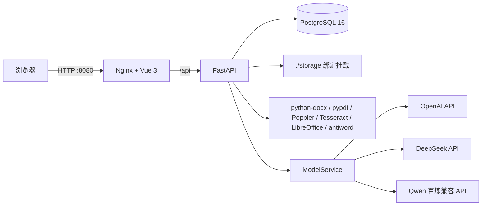

# 合同审查助手项目概览

> 整理日期：2026-08-06  
> 依据范围：仅使用当前目录内的代码、Alembic 迁移、配置、测试和 `README.md`；未访问或依赖其他项目目录。

## 1. 项目定位与总体结论

这是一个前后端分离的合同 AI 风险审查系统。用户登录后上传一份主合同和最多三份附件，后端解析文档、固化场景/规则/模型快照、调用模型、校验并定位风险，最后提供网页结果、历史记录、风险反馈和带标记文件下载。管理员额外维护用户、全局模型、审查规则和审查场景。

当前副本经最小修复后可以独立运行。修复前 Compose 默认采用目录名 `code` 作为项目名，曾命中另一套同名 Compose 项目的既有容器和 `code_postgres-data` 卷。现已由 `COMPOSE_PROJECT_NAME` 显式隔离，当前副本使用 `contract-review-current_postgres-data`，旧容器和旧卷只停止、未删除。

## 2. 目录结构与职责

```text
.
├── docker-compose.yml          # PostgreSQL、FastAPI、Nginx 前端编排
├── .env / .env.example         # 实际配置与安全模板
├── README.md                   # 功能、部署、接口和已知限制
├── backend/
│   ├── app/
│   │   ├── api/                # health/auth/contracts/review/rules/scenes/models 路由
│   │   ├── core/               # 配置、依赖注入、鉴权、加密和时间工具
│   │   ├── database/           # SQLAlchemy Engine、Session
│   │   ├── models/             # ORM 数据模型
│   │   ├── schemas/            # Pydantic 请求、响应和模型输出约束
│   │   ├── service/            # 认证、文件、文档、模型、审查和配置业务层
│   │   ├── providers/          # OpenAI、DeepSeek、Qwen Provider
│   │   ├── prompts/            # 合同审查 Prompt 组装
│   │   └── main.py             # FastAPI、CORS、启动恢复与管理员初始化
│   ├── alembic/                # 0001 至 0009 的线性迁移链
│   ├── scripts/                # 历史清理和真实模型冒烟脚本
│   ├── tests/                  # 权限、配置、文件、审查、恢复和清理测试
│   ├── Dockerfile              # Python 及 LibreOffice/OCR/Poppler/字体运行时
│   └── docker-entrypoint.sh    # 配置校验、Alembic 自动升级、启动 API
├── frontend/
│   ├── src/api/                # Axios 客户端及各业务 API 封装
│   ├── src/router/             # 登录、普通用户和管理员路由守卫
│   ├── src/stores/             # 登录用户与全局状态
│   ├── src/views/              # 登录、合同审查、规则、场景、模型页面
│   ├── src/assets/             # 样式和 Logo
│   ├── nginx/default.conf      # SPA 回退、/api 反向代理、健康检查
│   └── Dockerfile              # Node 生产构建 + Nginx 静态服务
├── storage/
│   ├── contracts/              # 上传原件、附件、解析清单和预览 PDF
│   ├── results/                # 带标记 DOCX/PDF
│   ├── temp/、tmp/             # 转换和渲染临时工作目录
│   └── attachments/            # 预留附件目录
├── deploy/nginx/default.conf   # 独立反向代理示例，不被当前 Compose 前端镜像使用
└── docs/                       # 本概览和本地部署文档
```

## 3. 技术架构



- 前端：Vue 3、TypeScript、Vite、Vue Router、Pinia、Element Plus、Axios。
- 网关：Nginx 提供编译后的 SPA；`/api/` 转发到 Compose 内部 `backend:8000`。
- 后端：FastAPI、Pydantic、SQLAlchemy 2、Alembic、httpx。
- 数据库：PostgreSQL 16，保存账号、会话、配置、任务、风险和反馈。
- 文件：宿主机 `./storage` 绑定到容器 `/app/storage`。
- 后台任务：FastAPI 进程内 `BackgroundTasks`，未使用独立队列。

## 4. 核心业务流程

### 4.1 登录与会话

1. `GET /api/auth/captcha` 生成四位数字图片验证码；数据库仅保存验证码哈希、过期时间和使用状态。
2. 注册/登录必须提交邮箱、密码、验证码 ID 和验证码；验证码一次性消费。
3. 密码采用 PBKDF2-SHA256、随机盐和 310,000 次迭代摘要。
4. 成功后返回随机 Bearer Token；数据库仅保存 SHA-256 Token 哈希和过期时间。
5. 每次请求联查 `user_session` 和 `app_user`，校验有效期及账号启用状态。

### 4.2 合同上传与解析

1. `POST /api/contracts/upload` 要求登录，接收一份主文件和最多三份附件。
2. `FileService` 校验文件名、扩展名、空内容、数量和单文件大小；支持 DOC、DOCX、PDF、TXT。
3. 每次上传生成 UUID 目录 `storage/contracts/<upload_id>/`，原件使用固定安全文件名保存。
4. 解析方式：
   - TXT：按 UTF-8/GB18030 等候选编码读取；
   - DOCX：`python-docx` 提取段落和表格，并用 LibreOffice 生成真实分页预览；
   - DOC：macOS 优先 `textutil`，Linux 使用 `antiword`，预览依赖 LibreOffice；
   - PDF：`pypdf` 提取原生文本，文本不足时使用 Poppler 渲染和 Tesseract `chi_sim+eng` OCR。
5. 生成 `manifest.json`，记录用户归属、内容、页、块、OCR 状态、原件和预览路径。路径为容器内 `/app/storage/...`；加载时若路径变化，会按上传目录和文件名重定位。

### 4.3 创建任务、模型调用与风险审查

1. `POST /api/review/create` 校验上传归属、总字符上限、场景启用状态及启用规则；`Idempotency-Key` 在同一用户内唯一。
2. 创建任务时固化：合同/附件文本、页面和块、场景名称、System Prompt、规则全集、模型 Provider/名称/Base URL/生成参数。模型快照不保存 API Key。
3. 任务在进程内按五个步骤更新进度：解析材料、读取配置、模型识别、合并校验、保存结果。
4. `Prompt` 模块把立场、尺度、材料和规则组装为消息；`ModelService` 根据任务模型快照选择 OpenAI、DeepSeek 或 Qwen Provider。
5. 模型必须返回 JSON。后端用 Pydantic 校验摘要、风险等级和字段，再执行规则 ID 白名单、重复项去重和原文定位；模型返回快照外规则时任务失败。
6. 成功后写入任务摘要和 `review_risk`；异常转为 `FAILED`，保存适合用户查看的错误并支持重试。

### 4.4 风险定位、结果与下载

- 风险定位以 `source_file_id + page_number + block_id + start/end offset + anchor hash` 为稳定锚点，可跨多个文本块并支持附件。
- 定位优先使用模型原文、指定文件、页码和上下文；来源不明确时仅在唯一匹配材料中落点，否则标记为需人工核验。
- 结果接口返回摘要、风险统计、风险明细、所有材料元数据和反馈状态。
- 文本页和原版式 PNG 均按页加载；风险卡与原文页码/块双向联动。
- PDF/TXT/DOC 下载生成带高亮和批注的 PDF；DOCX 默认保留原格式生成带标记 DOCX，也可导出 PDF。文件缓存于 `storage/results/<task_id>/`。

## 5. 用户、管理员和权限控制

| 能力 | 普通用户 | 管理员 | 后端约束 |
| --- | --- | --- | --- |
| 注册、登录、退出 | 是 | 是 | 验证码、密码摘要、会话哈希 |
| 上传与发起审查 | 是 | 是 | 必须登录，上传和任务绑定用户 ID |
| 历史、结果、页、下载、反馈 | 仅本人 | 仅本人 | 每个查询都包含 `ReviewTask.user_id == 当前用户` |
| 读取可用场景 | 是 | 是 | 仅返回启用且至少含一条启用规则的场景 |
| 规则 CRUD/启停 | 否 | 是 | 路由统一依赖 `require_admin` |
| 场景 CRUD/启停 | 否 | 是 | 路由统一依赖 `require_admin` |
| 模型 CRUD/启停/连接测试 | 否 | 是 | 全局配置，仅管理员维护；列表只返回掩码 |
| 用户查询、角色/状态、密码重置 | 否 | 是 | 普通用户返回 403；禁止操作自己和取消最后一个启用管理员 |

前端路由和导航会按角色隐藏/拦截管理页面，但安全边界由后端 401/403 和资源归属过滤实现。当前只有 `user`、`admin` 两种固定角色，没有组织、多租户或细粒度 RBAC。

## 6. 主要数据结构

| 表 | 关键内容 |
| --- | --- |
| `app_user` | 邮箱、密码摘要、角色、启停、创建和最后登录时间 |
| `user_session` | 用户、Token 哈希、过期和创建时间 |
| `auth_captcha` | 验证码哈希、过期、使用状态 |
| `user_operation_log` | 操作管理员、目标用户、角色/状态/密码动作、变更前后值和时间；不保存明文密码 |
| `review_rule` | 业务规则 ID、名称、类型、风险级别、要求、描述、启停 |
| `review_scene` | 场景名称、System Prompt、说明、顺序、启停 |
| `scene_rule_relation` | 场景与规则多对多关系 |
| `model_config` | Provider、模型、Base URL、Fernet 加密 Key、参数、启停；数据库约束最多一个启用模型 |
| `review_task` | 用户、幂等键、材料文本、场景/模型/文档快照、状态进度、摘要和错误 |
| `review_risk` | 规则、风险等级、原文、说明、建议及稳定定位字段 |
| `review_risk_feedback` | 用户、任务、风险、规则、反馈内容和时间；每个任务风险最多一条 |

配置删除或修改不会改变已有任务的场景和规则快照。模型任务快照不复制 Key，重试时按 Provider、模型名和 Base URL 重新找到全局配置并读取当前密钥。

## 7. Docker、存储与数据库持久化

- `postgres` 使用命名卷 `<COMPOSE_PROJECT_NAME>_postgres-data`；`docker compose down` 保留卷，`down -v` 会删除卷，日常操作禁止使用。
- `backend` 将当前目录 `./storage` 绑定到 `/app/storage`，所以复制目录会复制当时已有文件，但之后两个副本各写各自目录。
- 数据库命名卷不属于代码目录，复制文件不会复制 PostgreSQL 数据；若 Compose 项目名碰撞，则可能意外复用旧卷。
- `backend` 等待数据库健康后执行 `alembic upgrade head`；当前迁移为从 `20260803_0001` 到 `20260806_0009` 的单一线性链。
- `frontend` 等待后端健康后启动，三个服务位于 Compose 默认网络，通过服务名互联。

## 8. 本次独立运行验证

| 项目 | 结果 |
| --- | --- |
| `docker compose config` | 通过 |
| 镜像构建与启动 | 通过；创建独立网络和独立 PostgreSQL 卷 |
| PostgreSQL / 后端 / 前端健康 | 全部 healthy |
| Alembic 自动迁移 | 0001 至 0009 为单一迁移链，当前 head 为 `20260806_0009` |
| 初始种子 | 8 条规则、3 个场景、1 个全局模型配置、1 个初始化管理员 |
| 登录页、后端健康、Nginx `/api` 代理 | 200 |
| OCR 运行时 | Poppler、Tesseract、`chi_sim`、`eng` 全部就绪 |
| 前端生产构建 | 成功，1093 个模块 |
| 后端测试 | 用户管理专项 6 项通过；全量 59 passed |
| 管理员登录与模型读取 | 登录 200，角色 admin；活动模型和密钥来源可脱敏读取 |
| 合同全链路 | 上传 201；真实 DeepSeek 审查成功；6 条风险；页定位 200；PDF 下载 200 |

验证任务在当前新库中留下 1 条任务和 6 条风险，验证上传及结果留在当前 `storage`。未删除任何规则、场景、上传文件、旧容器或旧数据库卷。

## 9. 已知边界

- 后台审查在 FastAPI 进程内运行，服务重启会将处理中任务标为失败，不能断点续跑。
- 模型调用缺少持久队列、流式输出、自动重试、限流和费用统计。
- OCR、DOC 和版式转换依赖系统组件；容器镜像已包含，宿主机直跑需自行安装。
- 复杂 PDF 字体、扫描件或拆分文本可能只能生成页级批注，无法精确高亮。
- 管理配置删除不可恢复；生产环境应加强备份、审计和变更流程。
